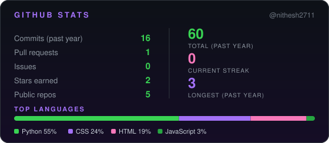

# Hi, I'm Nithesh V 👋

<b>Computer Science and Engineering Student &nbsp;|&nbsp; Aspiring Software Developer</b>

I love technology and software development, and I enjoy turning ideas into practical solutions through code.

##  About Me

- 🎓 Pursuing **B.E. in Computer Science and Engineering** at **Gopalan College of Engineering and Management**
- 💡 Interested in **Software Development**, **Web Development**, and **Computer Networking**
- 🔭 Currently developing **NetCanvas**, an interactive networking learning platform
- 🌱 Continuously learning new technologies and improving my problem-solving skills
- 🤝 Open to collaborating on innovative projects and learning opportunities

##  Languages & Technologies

  

##  GitHub Stats

  

##  Contribution Arcade

  

<i>A tiny bird flaps through my real contribution graph. Regenerated automatically twice a day.</i>

##  Connect With Me

  
  &nbsp;&nbsp;
  
  &nbsp;&nbsp;
  

<i>Building ideas into reality, one line of code at a time.</i>

